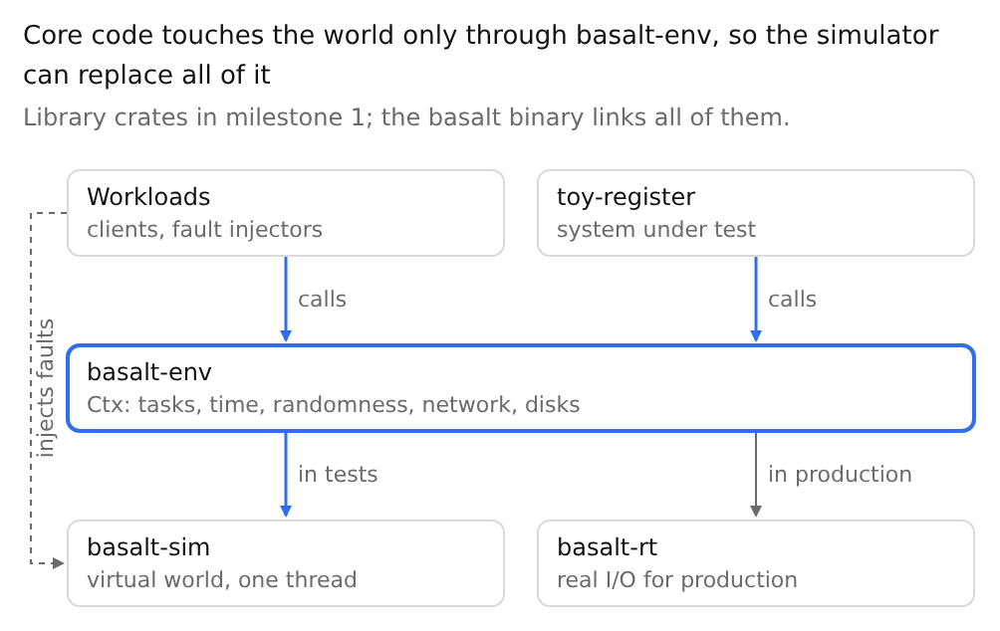

# Milestone 1: simulator design

Status: built (T1–T15 of the milestone 1 plan). The acceptance run on 2026-11-19 met every check under "What done means" except one: 10,000 seeds passed with both bugs off, not yet 100,000. A 60-second register test takes 0.69 seconds of wall time on average in a sweep, under the 1-second target, though about 1 seed in 10 takes 1 to 1.2 seconds. Last updated 2026-11-19.

Milestone 1 builds a FoundationDB-style simulator in Rust. All of Basalt's code runs as plain Rust futures on our own single-threaded executor, built on `async-task`, and reaches time, randomness, network, and disks only through one context type, `Ctx`, passed explicitly. Diagnostics (`buggify!`, `probe!`, `trace!`, and knobs) are ambient, because they never depend on which process is acting. In tests, a simulated world implements `Ctx`. In production, a thin real-I/O backend implements it. We prove the simulator by finding two planted bugs in a toy replicated register and replaying each failure exactly from its seed. The shipped `basalt` binary includes the simulator from day one, so `basalt sim` runs against the exact build that gets deployed.

## Decisions so far

| Decision | Choice | Why |
| --- | --- | --- |
| Language | Rust | Settled. |
| Raft | Our own | It must run under the simulator. |
| Simulation scope | The whole binary, as in FoundationDB | Every process, the network, disks, and clocks are simulated in one thread. |
| Task layer | `async-task` 4.x | It handles wakers, reference counts, and cancellation, and we own scheduling. |
| Production runtime | Our own single-threaded executor on `async-task`, with `async-io` for sockets and timers | Simulation and production share scheduling rules. Futures don't need to be `Send`. |
| Scaling across cores | Several single-threaded shards per node, talking over channels | The simulator models shards as processes on one machine, as FoundationDB does. |
| Core code is `Send`? | No | `Rc` and `RefCell` are allowed, with no locks in core code. |
| Context | Explicit `Ctx` for capabilities, an ambient world for diagnostics | Process identity can't go wrong, and fault points in leaf code need no plumbing. |
| Where the simulator ships | Inside the `basalt` binary, as `basalt sim` | The build that is tested is the build that is deployed, and users can run simulation on their own hardware. |
| hyper | Not in milestone 1. In milestone 2 it moves to an HTTP crate, behind a small newtype over `Stream` that implements hyper's `rt::Read`/`rt::Write`. HTTP/1 only, with no hyper `Timer` or `Executor`, and `auto_date_header(false)` with the `Date` header set from `ctx.wall_clock()`. | `basalt-env` stays free of hyper and of the `tokio` it pulls in, so `cargo-deny` can ban `tokio` outright. hyper's own `Date` header reads the real clock, which would break determinism. |

## Core code reaches the world only through `basalt-env`



| Crate | Role | May depend on |
| --- | --- | --- |
| `basalt-env` | The `Ctx` type, the ambient world behind `buggify!`, `probe!`, `trace!`, and knobs, time and address types, I/O errors, deterministic collections, and the static registry of every `buggify!` site and probe | `async-task`, `futures-io`, `linkme` |
| `basalt-sim` | The simulated world: executor, virtual time, network, disks, machines and processes, BUGGIFY, per-seed knobs and swarm configs, and the fault control API | `basalt-env` |
| `basalt-rt` | The production backend: the executor loop, the `async-io` reactor, a file I/O pool, and a compute pool | `basalt-env`, `async-io` |
| `basalt-harness` | The workload trait, test specs, the seed runner and sweep CLI with its coverage report, the linearizability checker, and the register's workloads | `basalt-env`, `basalt-sim`, `toy-register` |
| `toy-register` | The milestone 1 system under test (an ABD register) | `basalt-env` |
| `basalt-server` | `basalt server`: a register replica on `basalt-rt` | `basalt-rt`, `toy-register`; never `basalt-sim` or `basalt-harness` (enforced by `cargo-deny`) |
| `basalt` | The one shipped binary: `basalt server` runs on `basalt-rt`, `basalt sim` runs tests on `basalt-sim` | Everything above |

Later crates (`basalt-raft`, `basalt-meta`, `basalt-s3`) follow the same rule as `toy-register`: they depend on `basalt-env` and never on a backend. Only the `basalt` binary picks a backend, at startup, from its subcommand.

## Everything that acts as a process goes through an explicit `Ctx`

Every component receives a `Ctx`, a cheap clone of an `Rc` that knows which process it belongs to. A task spawned, a connection opened, or a file written through process A's `Ctx` belongs to A, wherever the call runs: inside a poll, in a `Drop` during a kill, or in workload code touching a server object directly. Because `Ctx` holds an `Rc`, it isn't `Send`, so a closure passed to `compute` can't capture it, and pool threads can't do I/O or read the clock. That's a compile error, not a runtime check. Behind it sits `Rc<dyn Backend>`, implemented by `basalt-sim` and `basalt-rt`. The same compiled code runs in either world, which is what lets the shipped `basalt` binary include the simulator, like `fdbserver -r simulation`.

```rust
#[derive(Clone)]
pub struct Ctx { backend: Rc<dyn Backend>, process: ProcessId }

impl Ctx {
    // Tasks
    pub fn spawn<F: Future + 'static>(&self, name: &'static str, prio: Priority, f: F) -> Task<F::Output>;
    pub async fn yield_now(&self);

    // Time
    pub fn now(&self) -> Instant;              // monotonic; virtual in simulation
    pub fn wall_clock(&self) -> SystemTime;    // per machine; skew and jumps in simulation
    pub fn sleep(&self, d: Duration) -> Sleep;
    pub fn timeout<F: Future>(&self, d: Duration, f: F) -> impl Future<Output = Result<F::Output, Elapsed>>;

    // Randomness
    pub fn rng(&self) -> &Rng;                 // u64, ranges, bool(p), shuffle

    // Network: TCP-like byte streams
    pub async fn listen(&self, port: u16) -> io::Result<Listener>;
    pub async fn connect(&self, addr: SocketAddr) -> io::Result<Stream>;

    // Disks
    pub fn disks(&self) -> Rc<[DiskId]>;
    pub fn disk(&self, id: DiskId) -> Disk;

    // CPU-heavy work (erasure coding, checksums later)
    pub async fn compute<T: Send + 'static>(&self, cost: Cost, f: impl FnOnce() -> T + Send + 'static) -> T;
}
```

- **`Task<T>`** wraps `async_task::Task`. Dropping it cancels the future. `detach()` hands the task to its process's task set instead of leaking it, so killing a process still drops it.
- **`Stream`** implements `futures-io` `AsyncRead`/`AsyncWrite` and nothing else. Protocols such as HTTP are layered on top of it in their own crates, so `basalt-env` stays free of protocol dependencies.
- **Disk operations are submitted when called**, not when first polled, and complete even if their future is dropped, as io_uring and a thread pool both behave.
- **Disk I/O takes owned buffers** (`write_at(buf: Vec<u8>, offset) -> (io::Result<()>, Vec<u8>)`), so moving to io_uring later doesn't change the API.
- **`compute`** runs inline in simulation, with the ambient world suspended so the job sees what a production pool thread sees, and charges `cost` in virtual time. In production it runs on a thread pool, the only place where `Send` is required.

```rust
impl Disk {
    pub async fn open(&self, path: &str, opts: OpenOptions) -> io::Result<File>;
    pub async fn rename(&self, from: &str, to: &str) -> io::Result<()>;
    pub async fn remove(&self, path: &str) -> io::Result<()>;
    pub async fn list(&self, dir: &str) -> io::Result<Vec<String>>;
    pub async fn sync_dir(&self, dir: &str) -> io::Result<()>;
    pub fn space(&self) -> Space;
}
impl File {
    pub async fn read_at(&self, buf: Vec<u8>, offset: u64) -> (io::Result<usize>, Vec<u8>);
    pub async fn write_at(&self, buf: Vec<u8>, offset: u64) -> (io::Result<()>, Vec<u8>);
    pub async fn sync(&self) -> io::Result<()>;
    pub async fn set_len(&self, len: u64) -> io::Result<()>;
    pub fn len(&self) -> u64;
}
```

## Diagnostics read an ambient world instead of `Ctx`

Each thread has at most one world, so diagnostics can find it without knowing the current process. The backend installs the world in a thread-local for its whole lifetime, not per poll, so the value can't go stale between tasks.

```rust
// basalt-env: the whole ambient API. Nothing process-scoped may be added here.
buggify!()                      // -> bool
buggify!(0.01)                  // -> bool, fires with this probability when switched on
probe!("raft.vote_after_lost_log")
trace!(Info, "ReplicaWrite", ts = ts, bytes = len)
knobs()                         // -> Rc<Knobs>
is_simulated()                  // -> bool
```

|  | Simulated world | Production world | No world (unit tests, `compute` jobs) |
| --- | --- | --- | --- |
| `buggify!()`, `buggify!(p)` | Per-site switch drawn from the seeded BUGGIFY stream | `false` | `false` |
| `probe!` | Counts hits for the sweep's coverage report | Counter for metrics | No-op |
| `trace!` | Recorded with virtual time; part of the unseed hash. An `Error` event fails the run | Written to the log | No-op |
| `knobs()` | Defaults, some randomized per seed | Defaults plus config | Defaults |

- **Trace events carry a process label** taken from the task being polled, when there is one. The label is only for reading traces; no behavior depends on it, so a wrong label during a kill misleads a reader but can't break a run.
- **The rule:** an ambient call may draw randomness and record things, but must never create, own, or address anything. Spawning, I/O, clocks, and `ctx.rng()` stay on `Ctx`.

## The simulator runs every process in one thread on virtual time

The run loop follows FoundationDB's `Sim2::runLoop`:

```text
loop:
    if no task is ready:
        if no timer is pending: report a hang, listing every blocked task by name
        jump time to the next timer (rarely adding a small random extra)
        fire the due timers
    take the next ready task: highest priority first, then FIFO or a seeded shuffle
    if the task's process has died since it was scheduled: drop it
    else: set the trace label to the task's process and poll the task
```

- **Time moves only between tasks.** Polling costs no virtual time unless the code calls `compute`.
- **Ordering among ready tasks of equal priority** is FIFO or a seeded shuffle, chosen per seed. Production order depends on I/O timing anyway, so shuffling explores orders that can really happen.
- **Priorities** are a small enum: `Coordination`, `Replication`, `Default`, `Background`.
- **`Sleep` and `delay`** sometimes get extra random delay when BUGGIFY is on, as in FoundationDB.
- **The `schedule` callback asserts it runs on the simulator thread.** `async-task` wakers are `Send`, so a dependency waking a task from another thread would break determinism. The assertion catches it.
- **An `Error` trace fails the run**, as in FoundationDB. `Error` is for things that must never happen, so every error trace is an assertion the sweep checks; faults the system is built to survive use `Warn`.
- **A panic in any task fails the run.** The binary is built with `panic = "abort"` for both subcommands. A panic hook first prints the seed and commit hash when a simulated world is installed, then the process aborts. In production, the supervisor restarts it.
- **Simulation runs the release build**, so invariant checks inside core code use `assert!`, not `debug_assert!`. Checks too expensive for production go behind `is_simulated()`.

### Machines, processes, and kills

Machines carry a failure zone and a set of disks. Each process runs an entry point `fn(Ctx) -> LocalBoxFuture<'static, ()>` and owns its task set. A kill wakes every task of the process and drops them all before any other task runs, so every future of that process is dropped, including tasks parked forever and tasks whose handle another process holds; stale runnables are discarded when they come up. A reboot reruns the entry point against the same disks as a new incarnation with a fresh `ProcessId`. Ids are never reused, so a `Ctx` kept from before the kill stays dead: tasks it spawns are dropped unpolled, and its I/O fails.

| Kill type | Unsynced writes | Use |
| --- | --- | --- |
| `Crash` | Survive, because the OS page cache outlives the process | Process crash or OOM kill |
| `PowerCut` (whole machine) | Each pending page is kept, dropped, torn, or corrupted | Durability bugs |
| `DiskFail` | The disk is gone | Rebuild paths later |
| `Wipe` | The process returns with empty disks | Replacement node |

Separating `Crash` from `PowerCut` goes further than FoundationDB. A missing fsync only shows up under a power cut, and that's the bug class a storage system must find.

### Network: TCP-like streams with clogging and partitions

- Each connection is two ordered byte pipes. Each chunk is delayed by a latency model: fast 99.9% of the time, with a long tail, like FoundationDB's `halfLatency`.
- Faults: clog a pair, all sends, or all receives for a duration; one-way and two-way partitions (a stalled connection eventually resets); random connection resets; a per-link bandwidth limit.
- Packets aren't dropped or duplicated inside a stream, just as with real TCP. Reordering and duplicate messages come from reconnects and retries in the code above. A `buggify!` site in the messaging layer also resends.

### Disk: nothing is durable until it's synced

- Each file has a durable image and a list of pending writes since its last `sync`. Creating, renaming, and removing files is also pending until `sync_dir`.
- Each file picks a corruption mode at open: drop only, or full corruption with torn sectors. A power cut applies that mode to each pending page.
- Other faults: a full disk (`ENOSPC`), read and write errors (`EIO`), rare bit flips on read, and latency from an IOPS and bandwidth model.
- Every operation is submitted when it's called, in both backends: a change it makes lands even if its future is dropped, and operations in flight together complete in any order. The simulator spreads each disk's operations over 4 queues. If a process dies with an operation in flight, the operation may or may not land.
- The model is deliberately weaker than real filesystems. Code that is correct on it is correct on ext4 and XFS, not the other way around.

### Clocks

The monotonic clock is shared virtual time, with an optional drift rate per machine. The wall clock is virtual time plus a per-machine offset, which the fault workload skews and jumps.

## Randomness comes from one seed and is checked at the end

- Every draw comes from the run's seed, split into named streams: `Rng::derive(seed, "network")`. The simulator keeps one stream each for scheduling, the network, disks, faults and the swarm config, BUGGIFY, and `ctx.rng()`. With a single stream, one extra draw anywhere shifts every later draw, so flipping a planted bug's flag would also change which faults hit and when. With separate streams, the bug-on and bug-off runs of a seed see the same faults, as long as the fault workloads don't react to what the system under test does. Streams are named, not numbered, so adding one never shifts the others.
- Core code still sees one generator, `ctx.rng()`. `Rng::fork()` splits off an owned generator, for example to move into a `compute` job. Processes don't get their own streams: they affect each other through messages and scheduling anyway.
- The PRNG is our own xoshiro256** (about 20 lines), not the `rand` crate, so its output never changes with a dependency upgrade.
- **The unseed:** at the end of a run, the harness prints a hash of every stream's state and of the trace events. Running the same seed again must print the same value, or the run is nondeterministic. CI runs a sample of seeds twice.
- A failing seed reproduces on the same commit. The harness prints the seed together with the commit hash.

## BUGGIFY, knobs, and probes work from any code

- `buggify!()` is a per-site switch. A site is switched on for the whole run with probability 0.25 and then fires with probability 0.25, as in FoundationDB's `Buggify.h`. It is `false` in production.
- `buggify!(p)` fires a switched-on site with probability `p` instead, like FoundationDB's `BUGGIFY_WITH_PROB`. It is for faults that would stall a run if they fired a quarter of the time, such as resetting every connection.
- `Knobs` holds every tuning constant (timeouts, batch sizes, retry intervals). In simulation, each knob may be randomized within its declared range.
- `probe!("name")` counts how often a rare path is reached. The sweep reports probes that no seed hit, so we know when a test stops exercising what it claims to.
- **Swarm testing:** each seed enables a random subset of fault types and knob randomizations, so rare combinations get explored.

## Tests are workloads run in phases

```rust
trait Workload {
    async fn setup(&mut self, sim: &SimControl) -> Result<()>;
    async fn start(&mut self, sim: &SimControl) -> Result<()>;
    async fn liveness(&mut self, sim: &SimControl) -> Result<()>;
    async fn check(&mut self, sim: &SimControl) -> Result<()>;
}
```

1. **Setup.** Workloads prepare, before any fault.
2. **Chaos phase.** Client workloads run alongside fault workloads (attrition, power cuts, clogging, partitions, clock skew, full disks) for a set virtual duration.
3. **Quiet phase.** Every fault is lifted: machines reboot, links heal, disks get space back. Within a deadline, each workload's `liveness` must succeed, such as a fresh write and read. This checks liveness, which the safety invariants alone don't cover.
4. **Check.** Each workload runs the checkers over the history it recorded.

The runner drives the workloads from outside every process, with `Sim::block_on` on a plain future, so no kill or cancel can stop the test itself. Workloads time themselves on the world's clock (`SimControl::sleep` and `SimControl::timeout`), which no machine's drift or `buggify!` moves. A workload acts as a process through a `Process` it adds in the test's build, on a machine of its own. Faults hit that machine like any other: partitions cut its links, kills drop its requests in flight, and BUGGIFY delays its timers and cancels its detached tasks. So no machine is exempt from faults.

`SimControl` lives in `basalt-sim`, so production code can't reach the fault API. Test specs are Rust functions in milestone 1, with TOML specs later.

**Checkers in milestone 1:**

- A linearizability checker in the style of Porcupine (Wing and Gong search, split per key), run on histories recorded with invocation and response times.
- A durability checker: no acknowledged write is lost.
- The hang detector from the run loop.
- Any `Error` trace event during the run.

**Runner CLI:**

```sh
basalt sim run   --test register --seed 4711            # one run, full trace
basalt sim sweep --test register --seeds 0..100000 -j 32
basalt sim check-determinism --test register --seeds 0..200
basalt sim list                                         # tests built into this binary
```

A sweep starts `-j` child processes of the same binary, each running seeds one after another. With `panic = "abort"`, a failing seed takes down only its child; the parent records the seed and starts a new child for the rest of the range.

## Enforcing determinism

- `clippy.toml` `disallowed-methods` and `disallowed-types` in every crate except the two backends: `std::time::{Instant, SystemTime}::{now, elapsed}` and other waits on the real clock, `std::thread::spawn`, `std::fs`, `std::net` and Unix sockets, `std::env::var`, `std::process::Command`, `std::collections::HashMap` and `HashSet` with the default hasher (`basalt-env` provides versions with a fixed hasher), `rand::thread_rng`, and all of `tokio`. `disallowed-macros` bans `thread_local!` outside `basalt-env` and the backends, so the ambient world stays the only ambient state.
- `cargo-deny` bans `tokio` and other runtimes from the dependency graph, and allows reactor crates (`async-io`, `polling`, `futures-lite`) only under `basalt-rt`.
- The unseed check catches what the lints miss.

## The toy register proves the simulator finds real bugs

`toy-register` is an ABD multi-writer register on 3 or 5 replica processes:

- A write reads the highest timestamp from a quorum, then stores `(ts + 1, writer_id, value)` on a quorum.
- A read takes the highest value from a quorum, writes it back to a quorum, and returns it.
- Replicas persist to their disk and sync before acknowledging. Clients talk to replicas over `Stream` with length-prefixed messages, and reconnect and retry on errors.

Two bugs can be switched on with flags:

| Bug | What breaks | Faults needed to find it | Caught by |
| --- | --- | --- | --- |
| `skip-writeback`: reads return without writing back | Two reads see new then old (new-old inversion) | Message delay and clogging | Linearizability checker |
| `ack-before-sync`: replicas acknowledge before `sync` | A power cut on a majority loses an acknowledged write | Power cuts | Durability checker |

The demo: a sweep with a bug on finds a failing seed, `run --seed N` replays the identical trace, and the same seed passes with the bug off.

## Steps

- [x] Cargo workspace, `basalt-env` types, lints, and `cargo-deny` setup
- [x] `basalt` binary with `server` and `sim` subcommands, `panic = "abort"`, and the seed-printing panic hook
- [x] Simulator executor: virtual time, PRNG, processes, kill and reboot on `async-task`
- [x] Harness: test specs, runner, sweep, unseed check, traces
- [x] Simulated network with latency, clogging, partitions, and resets
- [x] Simulated disk with pending writes, power-cut corruption, full disk, and I/O errors
- [x] `buggify!`, randomized knobs, probes, and swarm configs
- [x] Linearizability and durability checkers
- [x] ABD register, workloads, and both planted bugs
- [x] Minimal `basalt-rt` and a smoke test running the register as 3 real processes on localhost

## What done means

- Each planted bug is found within 1,000 seeds, and 100,000 seeds pass with both bugs off.
- Rerunning any seed gives the same unseed.
- Every fault type and every `buggify!` site is hit at least once across the sweep.
- The same register code runs unchanged on `basalt-rt`.
- `basalt sim sweep` runs from the release binary, the same file a deployment would use.
- A 60-second simulated register test takes under 1 second of wall time. This is a target, not a measured number.

## Resolved questions

1. **Pass `Ctx` explicitly, or make it ambient?** FoundationDB uses a global `g_network` and a thread-local current process. Explicit passing makes every dependency visible and needs no thread-locals in core code, at the cost of an extra argument everywhere. **Decided (2026-11-13): split.** `Ctx` is explicit for spawning, time, randomness, network, disks, and compute. `buggify!`, `probe!`, `trace!`, and knobs read an ambient world. See "Diagnostics read an ambient world instead of `Ctx`".
2. **Should the shipped `basalt` binary include the simulator?** FoundationDB ships simulation inside `fdbserver`, so users can run it on their own hardware and builds. The cost is binary size and keeping test code in release builds. **Decided (2026-11-13): yes, from day one,** as `basalt sim`. Tests, workloads, and checkers are compiled into the release binary.

## Alternatives considered

- **madsim:** it swaps tokio for a simulated version. Rejected because it ties core code to tokio's API and its disk model can't express power cuts and torn writes.
- **turmoil:** it simulates only the network, on real tokio.
- **Tokio in production:** rejected because core code would have to be `Send`, and the simulator wouldn't explore multi-threaded interleavings.
- **A generic `E: Env` parameter instead of `dyn Backend`:** zero-cost, but the generic spreads through every type, and one binary can't run both worlds. We revisit this only if profiling shows dynamic dispatch matters next to I/O.
- **A compile-time switch (`cfg(sim)`):** rejected for the same reason: production and simulation would be different builds.
- **Fully ambient context, as in FoundationDB:** the most ergonomic, but the current process is only right inside a poll. Code running in a `Drop` during a kill, in a waker, or in workload code acts under the wrong identity, and a misattributed task survives its owner's kill. FoundationDB's `ASSERT(currentProcess == t.machine)` and `onProcess()` hops exist for this.
- **Fully explicit context:** safe, but every fault point and trace event in leaf code would need `ctx` threaded through all its callers, which discourages adding them.
- **A separate `basalt-sim` binary:** smaller release builds, but simulation would test a different build from the one deployed, and users couldn't check their own build on their own hardware.
- **Message-level network simulation:** faster, but production runs over TCP byte streams: framing, partial reads and writes, and connection resets are what real code must handle, and stream-level faults are what production sees. Protocol libraries layered on later, such as HTTP and TLS, also expect byte streams.

## Risks

- **A dependency hides nondeterminism.** For example, rustls draws nonces from `getrandom`; we'll inject our PRNG through its crypto provider when TLS arrives. Earliest signal: an unseed mismatch.
- **Code assumes work after an `.await` always completes.** Cancellation by drop breaks that assumption when a process is killed. Earliest signal: invariant failures right after kills. Mitigation: a coding guide ([Cancellation safety](../guides/cancellation-safety.md)) plus a `buggify!` that cancels tasks at random.
- **Byte-stream simulation is too slow for large sweeps.** Earliest signal: the 60-second register test takes more than 1 second. Mitigation: coalesce chunks on the fast path.
- **The disk model misses a real filesystem behavior.** Earliest signal: a bug in the field that simulation can't reproduce. Mitigation: keep the model weaker than real filesystems, and add behaviors as we learn them.
- **Process-scoped behavior creeps into the ambient API.** For example, someone adds an ambient `spawn` for convenience. Earliest signal: a change to the ambient section of `basalt-env`, which code review should treat as a design change.
- **A `buggify!` site sits in code that only runs off the simulator thread**, so it never fires. Earliest signal: the sweep's coverage report lists the site as never hit.
- **Test code bloats the release binary.** Earliest signal: binary size growing with each workload. Mitigation: keep heavy fixtures as data generated from the seed, not compiled tables.
- **Simulation-only code runs in production by mistake.** Earliest signal: `SimControl` or a workload becoming reachable from `basalt server`. Mitigation: `basalt server` lives in its own crate, `basalt-server`, and `cargo-deny` lets only `basalt-harness` (and `toy-register`'s tests) depend on `basalt-sim` and only the `basalt` binary depend on `basalt-harness`, so the server can't name a simulator type.
- **Boxed futures behind `dyn Backend` cost too much in production.** Earliest signal: allocation-heavy profiles in milestone 2 benchmarks.

## Out of scope for milestone 1

Raft, the S3 API, HTTP and TLS running under simulation (both can be layered on `Stream` later), io_uring, multiple shards in `basalt-rt`, shrinking failing runs, TOML test specs, and running sweeps across several machines.
